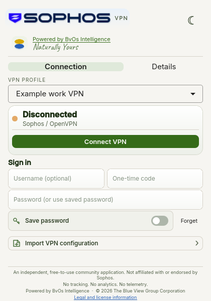

# Blue View Sophos VPN Client



A compact, independent Linux client for Sophos-compatible OpenVPN profiles. Originally created for [Omarchy Linux](https://omarchy.org/), it brings connection status, multiple VPN profiles, and a clean card-style interface to the desktop.

Built by [The Blue View Group Corporation](https://blueview.ai/) and the Neutrino AI Lab team, powered by [BvOs Intelligence](https://bvos.blueview.ai/)—Naturally Yours.

- **Made for the desktop:** A small Qt window with light and dark themes, connection details, and live tunnel traffic.
- **Profiles and credentials:** Import supported `.ovpn` files, switch between profiles, and optionally save passwords in the system keyring. Enter one-time codes separately.
- **Private by design:** No app telemetry or analytics. VPN profiles and settings stay on your system; the selected VPN server handles the connection.
- **Community-focused:** Free to use under the noncommercial license, with a public codebase, contribution guide, and private vulnerability reporting.

## Omarchy integration

The original Omarchy setup includes a Sophos icon in the system bar. It shows a connection indicator and opens the compact application when clicked; the network panel can also open it. The app's **Connection** and **Details** tabs provide the controls and information previously shown in the bar card.

The system-bar integration is currently a local Omarchy customization, **not yet included in the repository's installer**. The application itself can also run on other Linux desktops with the dependencies below. Contributions to package and simplify Omarchy integration are welcome.

## Requirements

Linux with NetworkManager, its OpenVPN plugin, OpenVPN, `nmcli`, `secret-tool`, `ip`, `notify-send`, a running Secret Service, Qt 6 Quick Controls, qmake6, a C++17 compiler, Rust and Cargo. The desktop file chooser uses Qt's desktop portal support.

## Build and run

```sh
bin/build
build/sophosvpn
```

To install the built app and launcher entry for the current user, run `bin/install-user`.

The build uses Cargo offline; ensure the Rust dependencies in `backend/Cargo.lock` are cached first, or run `cargo fetch --manifest-path backend/Cargo.toml` when online. Press Ctrl+Q to quit.

## Usage

Select **Import VPN configuration**, choose the `.ovpn` file supplied by your organization, then import it. Enter your VPN username and password and, if required, a one-time code from your authenticator or hardware token; then select **Connect VPN**. One-time codes are not saved. The app does not directly support FIDO2 security keys or Keeper integration. The application saves the password to the desktop keyring only when you enable the save option and the connection succeeds. Put one-time codes in their separate field, never in the password field when saving the password. Previously saved passwords remain available until you choose to forget them. Profile import creates a separate NetworkManager profile with split tunneling enabled. DNS and network routes are supplied by the VPN configuration and server; check your organization's VPN policy and test access after importing.

Multiple imported profiles remain available in the profile selector, with a separate saved password per profile. Disconnect before switching profiles.

The app does not bundle a VPN configuration or credentials. Existing NetworkManager profiles are not deleted. Only OpenVPN configurations supported by NetworkManager can be imported. New imports must specify a trusted CA and a server-certificate check; configurations containing unsupported executable directives or external file references may require a different profile from the administrator. Existing NetworkManager profiles are not revalidated by the importer.

## Independent community project

This free-to-use community application is not affiliated with, endorsed by, sponsored by, or supported by Sophos. See [legal and community information](LEGAL.md) for trademark, warranty, licensing, and networking disclosures.

## Contributing and security

See [MAINTENANCE.md](MAINTENANCE.md) for release and compatibility plans. See [CONTRIBUTING.md](CONTRIBUTING.md) for development and pull-request guidance and [SECURITY.md](SECURITY.md) for private vulnerability reporting and security limitations.

## License

Copyright 2026 The Blue View Group Corporation. Source available under the [PolyForm Noncommercial License 1.0.0](LICENSE); see [NOTICE](NOTICE). This is a noncommercial license, not an OSI-approved open-source license.

Sophos and the Sophos logo are trademarks of Sophos and are not licensed under the project license. Blue View branding is a trademark of The Blue View Group Corporation.

The Lexend Exa and Caveat typefaces are distributed under the SIL Open Font License 1.1; see [Lexend Exa](src/LexendExa-OFL.txt) and [Caveat](src/Caveat-OFL.txt).
